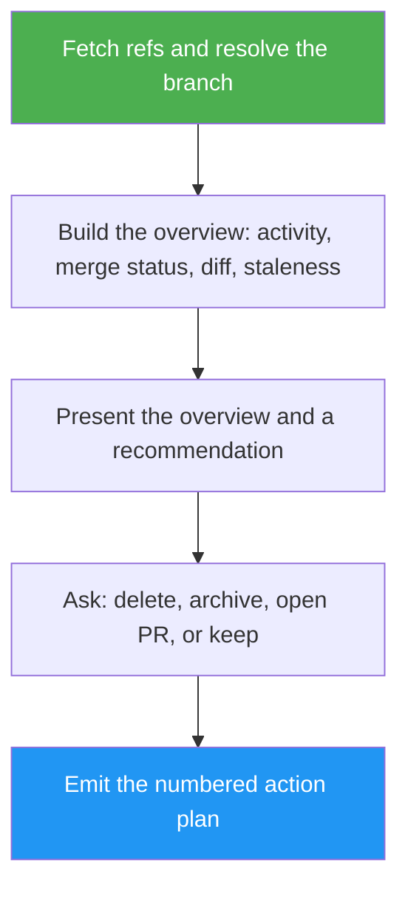

<!--
  DO NOT READ THIS FILE — This README.md is for human catalog browsing only.
  It ships inside the .skill package but is NEVER auto-loaded into agent context.
  The runtime loader only reads SKILL.md + references/ + scripts/ + agents/ when the skill triggers.
  If you're an AI agent, read the SKILL.md file instead for skill instructions.
-->

# Branch Inspector

> Inspect one git branch against `main`, explain what it implements, and get a delete / archive / PR / keep action plan with exact commands.

> **Note for AI agents:** This README is for humans. If you're an AI agent looking for instructions, read `SKILL.md` in the parent directory instead.

**Author:** Montimage

## Highlights

- Resolves the branch locally and on `origin`, and reports any divergence between them.
- Detects merge status, including squash merges via `git cherry`, plus staleness and conflict risk.
- Reads the actual diff to explain *what the branch implements*, not just its stats.
- Recommends a path, asks you to decide, then emits a numbered plan. Destructive commands are listed, never run by the skill.

## When to Use

| Say this... | Skill will... |
| --- | --- |
| "Look at `feature/foo` before I clean up" | Build a Branch Overview and recommend delete, archive, PR, or keep |
| "Is `experiment/x` worth keeping?" | Explain what the branch implements and how stale it is |
| "Should this old branch become a PR?" | Check merge status and conflict risk, then draft a PR plan |
| "Archive this branch" | Ask tag-and-delete vs rename, then list the exact commands |

Not for: reviewing a PR diff line by line (use a code-review skill), sweeping all stale branches at once (this skill handles one branch at a time), or full repo audits.

## How It Works



## Usage

```
/branch-inspector feature/some-experiment
```

## Requirements

- Git repository with a `main` (or equivalent) base branch.
- `gh` CLI is optional; used to detect linked PRs.

## Resources

| Path | Description |
| --- | --- |
| `references/overview-fields.md` | Fields to collect, git commands, conflict-risk and large-diff thresholds |
| `references/action-plans.md` | Plan templates for delete, archive (tag or rename), open PR, keep |
| `references/example-output.md` | Worked example of an overview, decision prompt, and plan |
| `references/review-criteria.md` | Checks that the output is understandable, not just correct |

## Output

A structured Branch Overview (with an uncertainty line), a decision prompt, and a numbered action plan ending with the approval it needs. The skill never executes destructive commands.
