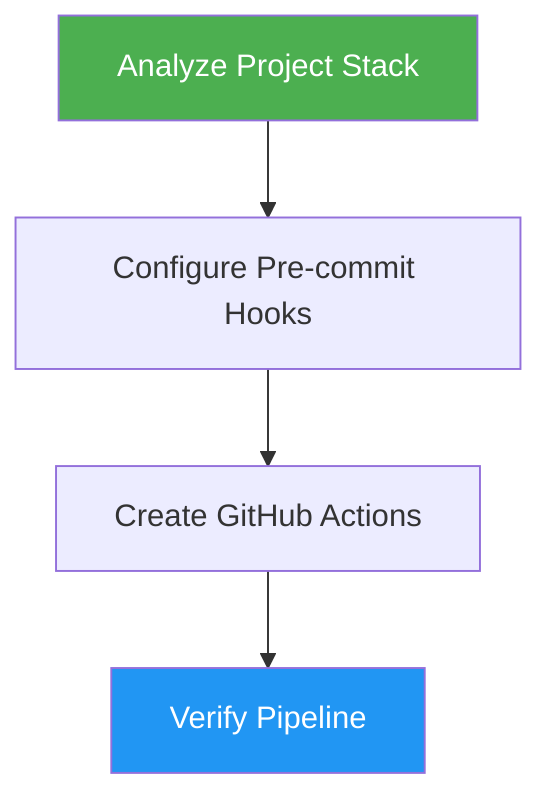

<!--
  DO NOT READ THIS FILE — This README.md is for human catalog browsing only.
  It ships inside the .skill package but is NEVER auto-loaded into agent context.
  The runtime loader only reads SKILL.md + references/ + scripts/ + agents/ when the skill triggers.
  If you're an AI agent, read the SKILL.md file instead for skill instructions.
-->

# DevOps Pipeline

> Configure pre-commit hooks and GitHub Actions for project quality gates.

**Author:** Montimage

## Highlights

- Auto-detects project languages, frameworks, and existing tooling
- Configures pre-commit hooks with language-appropriate tools
- Creates GitHub Actions CI workflows mirroring local checks
- Supports JS/TS, Python, Go, Rust, and Java ecosystems
- Creates feature branch before making changes

## When to Use

| Say this... | Skill will... |
|---|---|
| "setup CI/CD" | Create pre-commit hooks and GitHub Actions workflows |
| "add pre-commit hooks" | Configure `.pre-commit-config.yaml` for your stack |
| "create GitHub Actions" | Generate `.github/workflows/ci.yml` with caching and matrix testing |
| "add linting to CI" | Set up formatters, linters, and security checks |
| "configure CI pipeline" | Detect stack and build complete quality gate automation |

## How It Works



## Usage

```
/devops-pipeline
```

## Output

Creates `.pre-commit-config.yaml` and `.github/workflows/ci.yml` configured for the detected project stack with appropriate formatters, linters, type checkers, and security scanners, then reports the result, the verification commands run, what stays untested, and any approval needed before commit or push.

## Resources

| Path | Description |
|---|---|
| [`../references/discovery-agents.md`](../references/discovery-agents.md) | Briefs for the three parallel discovery agents |
| [`../references/precommit-configs.md`](../references/precommit-configs.md) | Tool selection and pre-commit configurations by language |
| [`../references/github-actions.md`](../references/github-actions.md) | GitHub Actions workflow templates |
