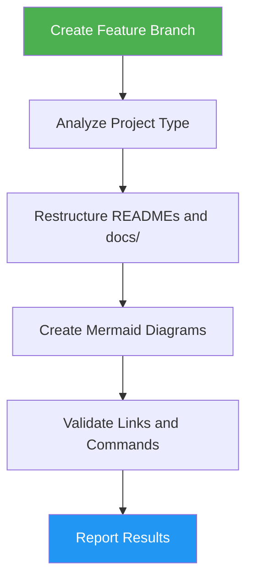

<!--
  DO NOT READ THIS FILE — This README.md is for human catalog browsing only.
  It ships inside the .skill package but is NEVER auto-loaded into agent context.
  The runtime loader only reads SKILL.md + references/ + scripts/ + agents/ when the skill triggers.
  If you're an AI agent, read the SKILL.md file instead for skill instructions.
-->

# Documentation Generator

> Generate project documentation structure and practical guides for the project type.

**Author:** Montimage

## Highlights

- Analyzes project type (library, API, web app, CLI, microservices)
- Streamlines root README.md as an effective entry point
- Creates component-level READMEs per module/package/service
- Generates Mermaid diagrams for architecture and data flow
- Organizes docs/ directory by category with quality checklist

## When to Use

| Say this... | Skill will... |
|---|---|
| "generate documentation" | Create docs/ structure with architecture, API, deployment guides |
| "write docs for this project" | Analyze project and create full documentation hierarchy |
| "the README is a mess" | Restructure root README as clean entry point with quickstart |
| "document my code" | Generate component READMEs and centralized docs/ |
| "add API docs" | Create api-reference.md with endpoints and examples |

## How It Works



## Usage

```
/docs-generator
```

## Resources

| Path | Description |
| --- | --- |
| `references/doc-targets.md` | Required content per README/docs page, page-selection rule, Mermaid example, writing guidelines |

## Output

Creates a structured documentation hierarchy including a streamlined root README.md, component-level READMEs, and a `docs/` directory with architecture, API reference, deployment, development, and troubleshooting guides as applicable, plus a short summary of the result, the checks run, anything left unverified, and any approval still needed.
