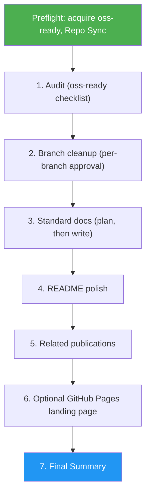

<!--
  DO NOT READ THIS FILE — This README.md is for human catalog browsing only.
  It ships inside the .skill package but is NEVER auto-loaded into agent context.
  The runtime loader only reads SKILL.md + references/ + scripts/ + agents/ when the skill triggers.
  If you're an AI agent, read the SKILL.md file instead for skill instructions.
-->

# OSS Ready Flow

> Prepare an end-to-end OSS release flow covering audit, branches, docs, README, publications, and optional Pages, with a user checkpoint after every step.

**Author:** Montimage · **Version:** 1.6.0 · **Depends on:** `oss-ready`

## Highlights

- Six sequential steps, one sub-agent per step, and a user checkpoint (`yes / skip / stop`) between steps
- Plan-only branch cleanup with per-branch approval; never force-pushes or commits for you
- Durable, append-only reports in `.oss-ready/` so a run can resume across sessions
- Final Summary that states the result, evidence, uncertainty, and the next decision

## When to Use

| Say this... | Skill will... |
| --- | --- |
| "Make this project open source end-to-end" | Run the full six-step flow from audit to optional landing page |
| "Full OSS prep for this repo" | Audit, clean branches, generate docs, and polish the README |
| "Clean up branches as part of the OSS release" | Start at the audit, then plan per-branch merge/delete/keep decisions |

**Don't use for** audit-only checks (use `oss-ready` directly), single-doc or README-only edits, or marketing sites.

## How It Works



| Step | Action | Sub-agent | Output |
|------|--------|-----------|--------|
| 1 | Audit current state (wraps `oss-ready` skill) | Auditor (read-only) | `.oss-ready/01-audit.md` |
| 2 | Branch cleanup — classify, plan, per-branch approval | Branch Analyst (read-only) | `.oss-ready/02-branches.md` |
| 3 | Standard docs (user, dev, deployment, architecture) | Docs Architect + Docs Writer | `.oss-ready/03-docs-plan.md`, `.oss-ready/03-docs-diffs.md` |
| 4 | README final polish | README Polisher | `.oss-ready/04-readme-draft.md`, `.oss-ready/04-readme-diff.md` |
| 5 | Related publications collection | Publications Researcher | `.oss-ready/05-publications.md` |
| 6 | Optional GitHub Pages landing page | Landing Page Builder | `.oss-ready/06-landing-page.md` |

## Usage

```
/oss-ready-flow
```

Requires `git`, the `asm` CLI (`npm install -g agent-skill-manager`), and the `oss-ready` skill; `gh` is optional for GitHub-side checks.

## Safety model

- **Plan-only by default.** Every destructive action (branch delete, history rewrite) requires per-item user approval.
- **No commits without explicit user request.** The skill writes files and shows diffs; the user runs `git commit`.
- **Reports are durable.** Everything lands in `.oss-ready/<step>.md` so the user can resume across sessions.
- **Always ask when ambiguous.** License choice, contact email, branch fate, publication list — no defaults assumed silently.

## How it relates to other skills

- **Wraps:** `oss-ready` (for the step-1 audit). The `oss-ready` skill remains usable on its own.
- **Reuses templates from:** `oss-ready`'s `assets/` directory (LICENSE, CODE_OF_CONDUCT.md, SECURITY.md, GitHub templates), resolved through `asm deps acquire`.

## Resources

| Path | Description |
| --- | --- |
| `SKILL.md` | The skill instructions (read by the agent) |
| `references/sub-agent-briefs.md` | Verbatim brief for each step's sub-agent and the dispatch rules |
| `references/expected-output.md` | Target layout, Step Completion Reports, Final Summary, review criteria |
| `references/edge-cases.md` | Edge cases and recovery |
| `references/assets-resolution.md` | `oss-ready` asset check and template copy commands |
| `references/safety-model.md` | Full approval and refusal rules |
| `evals/evals.json` | Trigger, negative-trigger, and Final Summary eval cases |

## Output

A `.oss-ready/` directory of per-step reports in the target repo, standard docs under `docs/`, a polished README with a Related Publications section, an optional GitHub Pages scaffold, and a Final Summary listing results, evidence, open uncertainty, and the commit for the user to run.
