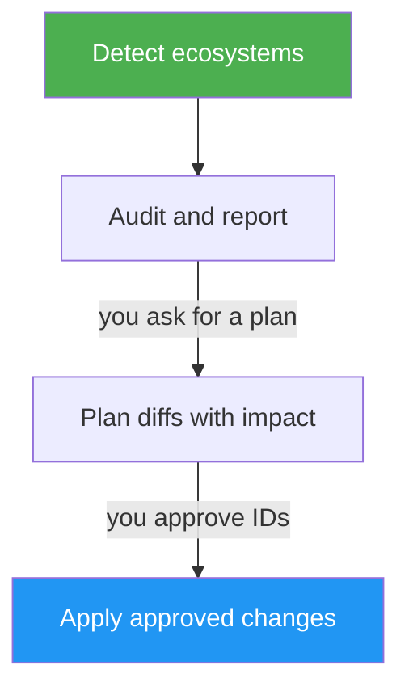

<!--
  DO NOT READ THIS FILE — This README.md is for human catalog browsing only.
  It ships inside the .skill package but is NEVER auto-loaded into agent context.
  The runtime loader only reads SKILL.md + references/ + scripts/ + agents/ when the skill triggers.
  If you're an AI agent, read the SKILL.md file instead for skill instructions.
-->

# Supply Chain Audit

> Audit dependency, container, and CI supply-chain controls before applying approved hardening changes.

**Author:** Montimage

A skill that audits a project's defenses against supply-chain attacks — compromised npm/PyPI packages, poisoned transitive dependencies, malicious post-install scripts, untrusted container base images, hijacked GitHub Actions — and applies layered fixes only after you approve them.

## Highlights

- Audits npm, Python, Docker, and GitHub Actions controls against recent supply-chain incidents.
- Reports every finding with quoted evidence, a severity, and a stable ID; lists anything it could not inspect under **Not verified**.
- Proposes exact diffs with honest impact and reversibility notes, then applies only the IDs you approve.
- Never commits or pushes; you review `git diff` yourself.
- Optionally proposes a small edit to itself when a run shows a lasting mismatch with your style or environment (applied only after you approve).

## What it does

1. **Detect** which ecosystems are in play (npm, Python, Docker, GitHub Actions).
2. **Audit** each ecosystem against a checklist drawn from 2024–2026 incident lessons (Axios, TanStack, eslint-config-prettier, tj-actions/changed-files, ultralytics).
3. **Report** findings with evidence, severity, and impact — no fixes applied yet.
4. **Plan** changes with concrete diffs and honest impact statements — still no fixes applied.
5. **Apply** only the changes you approve, then show the resulting diff for review.

The phase boundaries are gates. The skill stops and waits for explicit user input between audit → plan and plan → apply.

## When to use

| Say this... | Skill will... |
| --- | --- |
| "Audit supply chain" | Detect ecosystems and emit an evidence-backed audit report, then stop |
| "Harden dependencies" / "avoid supply chain attack" | Audit, then draft a change plan once you ask for one |
| "Run a supply chain audit on services/api" | Audit only that subdirectory |
| "Are we exposed to the latest npm incident?" | Check the cooldown, install-script, and lockfile controls that block that class of attack |

## How it works



## When not to use

- Runtime application vulnerabilities (use a SAST/DAST tool).
- Secret scanning in commits.
- Generic dependency bumps without a security goal (use Renovate/Dependabot directly).
- Cloud infra hardening (IAM, network policies).

## Coverage

| Ecosystem        | Trigger files                                          | Key controls audited                                              |
|------------------|--------------------------------------------------------|-------------------------------------------------------------------|
| npm/Node         | `package.json`, `package-lock.json`, `pnpm-lock.yaml`, `yarn.lock` | cooldown, `ignore-scripts`, `npm ci`, audit-in-CI, lockfile      |
| Python           | `pyproject.toml`, `requirements*.txt`, `Pipfile`, `uv.lock`, `poetry.lock` | `exclude-newer`, hashes, `pip-audit`, deterministic install      |
| Docker           | `Dockerfile`, `Dockerfile.*`, `docker-compose*.y*ml`   | digest pin, multi-stage, non-root, scan in CI, SBOM, no baked secrets |
| GitHub Actions   | `.github/workflows/*.y*ml`                             | SHA-pinned `uses:`, `permissions:`, OIDC, `pull_request_target`, script injection |

## Usage

```
/supply-chain-audit
```

Optionally name a sub-path:

```
> Run a supply chain audit on services/api
```

The skill will:

1. Print Phase 1 (Detect) — one-line summary.
2. Print Phase 2 (Audit) — full report.
3. **Stop.** Reply with "Plan it" or "Plan a subset: …" to continue.
4. Print Phase 3 (Plan) — diffs + impact.
5. **Stop.** Reply with "Approve all" or "Approve: …" to continue.
6. Print Phase 4 (Apply) — diff of what landed. Commit is left to you.

## Output

- Phase 2: an audit report (markdown) with executive summary, per-ecosystem findings, recommended-changes preview.
- Phase 3: a change plan with full unified diffs per change, each carrying an honest impact statement.
- Phase 4: a list of modified files plus the diff `git diff` would show.

## Honest about cost

Every change has a downside. The skill names them:

- `ignore-scripts=true` breaks packages with legitimate post-install (native modules, Prisma, Puppeteer).
- `min-release-age=7d` delays security patches by up to a week.
- Digest-pinned base images need Renovate to bump or they go stale on CVEs.
- `permissions: {}` breaks any job that writes back to the repo without explicit grants.

You decide whether the trade-off is worth it.

## Requirements

- A git repository (so we can show diffs before applying).
- At least one supported ecosystem manifest (see Coverage above).

## Evaluation

The skill was benchmarked against an unguided baseline on three eval cases (npm-only audit with phase gate, multi-ecosystem subset apply, empty-repo negative control). With-skill pass-rate **1.00** vs baseline **0.58**, at a cost of ~2× tokens and ~2.5× wall time.

See `SKILL.md` for the workflow and `../references/` for the ecosystem checklists, report template, change plan, and scoring rules.

## Resources

| Path | Description |
| --- | --- |
| [`../references/npm.md`](../references/npm.md), [`../references/python.md`](../references/python.md), [`../references/docker.md`](../references/docker.md), [`../references/github-actions.md`](../references/github-actions.md) | Per-ecosystem checklists and remediation snippets |
| [`../references/audit-report.md`](../references/audit-report.md) | Phase 2 report template |
| [`../references/change-plan.md`](../references/change-plan.md) | Phase 3 plan template |
| [`../references/scoring.md`](../references/scoring.md) | Posture rating rubric |
| [`../scripts/detect_ecosystems.sh`](../scripts/detect_ecosystems.sh) | Ecosystem detection helper |
| [`../evals/evals.json`](../evals/evals.json) | Eval cases with correctness and understanding assertions |
